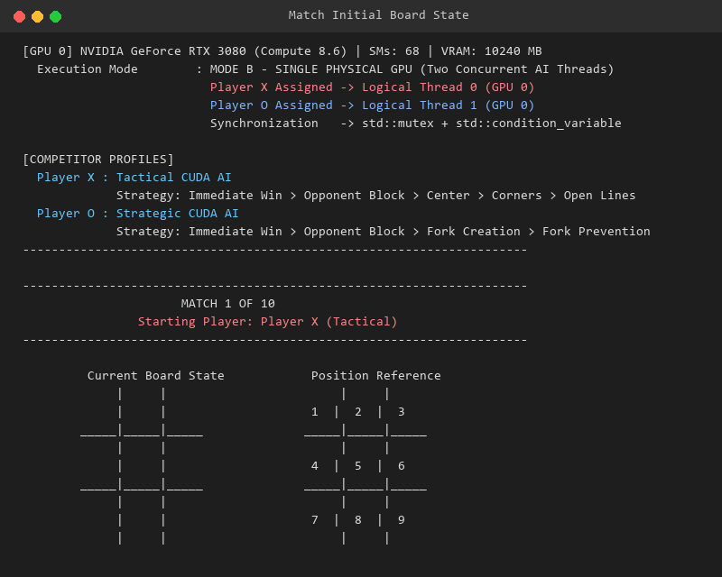
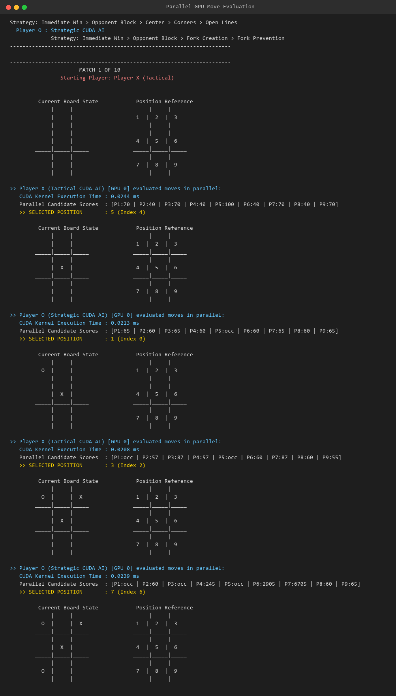
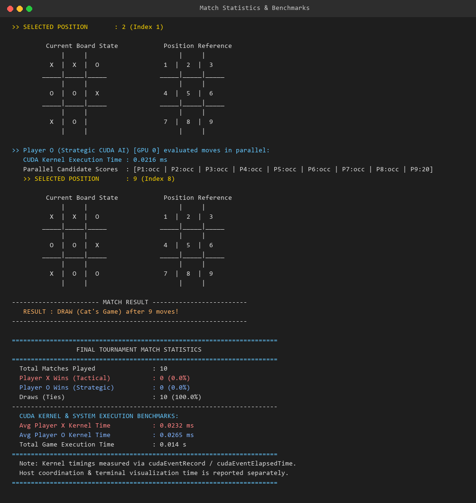

# CUDA GPU vs GPU – Intelligent Tic-Tac-Toe Battle

[](https://developer.nvidia.com/cuda-toolkit)
[](https://isocpp.org/)
[](LICENSE)
[](#system-requirements)

A high-performance, autonomous GPU-versus-GPU artificial intelligence game simulation developed in CUDA C++ for the Coursera GPU Programming Assignment. Two independent AI competitors—**Player X (Tactical CUDA AI)** and **Player O (Strategic CUDA AI)**—compete across a 10-match tournament, offloading their entire candidate-move evaluation logic to dedicated NVIDIA CUDA device kernels in parallel.

---

## Table of Contents

- [1. Project Introduction](#1-project-introduction)
- [2. Assignment Objective](#2-assignment-objective)
- [3. Project Features](#3-project-features)
- [4. Explanation of Both GPU Competitors](#4-explanation-of-both-gpu-competitors)
- [5. Different AI Strategies](#5-different-ai-strategies)
- [6. System Architecture](#6-system-architecture)
- [7. Project Directory Structure](#7-project-directory-structure)
- [8. CUDA Implementation Details](#8-cuda-implementation-details)
- [9. Explanation of CUDA Kernels](#9-explanation-of-cuda-kernels)
- [10. CUDA Threads and Blocks](#10-cuda-threads-and-blocks)
- [11. Host and Device Memory Management](#11-host-and-device-memory-management)
- [12. cudaMalloc and cudaMemcpy Lifecycle](#12-cudamalloc-and-cudamemcpy-lifecycle)
- [13. Kernel Launching and Synchronization](#13-kernel-launching-and-synchronization)
- [14. Multiple-GPU Execution (Mode A)](#14-multiple-gpu-execution-mode-a)
- [15. Single-GPU Fallback (Mode B)](#15-single-gpu-fallback-mode-b)
- [16. System Requirements](#16-system-requirements)
- [17. CUDA Installation Requirements](#17-cuda-installation-requirements)
- [18. Compilation Instructions](#18-compilation-instructions)
- [19. Execution Instructions](#19-execution-instructions)
- [20. Sample Output](#20-sample-output)
- [21. Match Statistics](#21-match-statistics)
- [22. Screenshots and Visual Demonstrations](#22-screenshots-and-visual-demonstrations)
- [23. Presentation & Slide Decks](#23-presentation--slide-decks)
- [24. Known Limitations](#24-known-limitations)
- [25. Future Improvements](#25-future-improvements)
- [26. Author Information](#26-author-information)
- [27. Acknowledgements](#27-acknowledgements)

---

## 1. Project Introduction

In traditional artificial intelligence implementations of board games like Tic-Tac-Toe, candidate moves are evaluated sequentially on the CPU through nested loops or depth-first recursive trees. While computationally trivial on modern CPUs, this sequential model does not showcase parallel acceleration.

**CUDA GPU vs GPU – Intelligent Tic-Tac-Toe Battle** redesigns move evaluation to utilize the massive data-parallel capabilities of NVIDIA GPUs. The $3 \times 3$ grid is mapped directly to a grid of CUDA threads. Rather than using CPU calculations or simulated random decisions, each AI competitor launches specialized CUDA kernels (`__global__`) that evaluate all 9 board positions simultaneously.

---

## 2. Assignment Objective

The primary objective of this project is to fulfill the Coursera GPU Programming course requirement:
1. Design a functional game powered by **at least two independent GPU-based competitors**.
2. Execute **genuine CUDA kernels** on NVIDIA GPU hardware for AI decision-making.
3. Demonstrate **parallel move evaluation** using CUDA thread hierarchies.
4. Implement rigorous **Host-Device memory communication** via `cudaMalloc`, `cudaMemcpy`, and `cudaFree`.
5. Support **dynamic dual-GPU execution** (`cudaSetDevice(0)` vs `cudaSetDevice(1)`) with automated **single-GPU fallback** using synchronized threads.
6. Measure micro-benchmarks accurately via **CUDA hardware events** (`cudaEventRecord`).
7. Provide a clean, readable terminal interface displaying live board state, candidate score vectors, and tournament statistics.

---

## 3. Project Features

- **Genuine GPU Computing**: 100% of candidate move evaluation occurs on GPU streaming multiprocessors (SMs).
- **Two Distinct AI Heuristics**:
  - *Player X*: Linear tactical heuristic optimizing center, corners, immediate wins, and open path propagation.
  - *Player O*: Deep non-linear strategic heuristic with multi-line fork creation and fork prevention.
- **Hardware-Aware Execution Modes**:
  - **Mode A (Dual Physical GPUs)**: Automatic binding of Player X to GPU 0 and Player O to GPU 1.
  - **Mode B (Single Physical GPU)**: Two AI worker threads time-sliced on GPU 0 with `std::mutex` and `std::condition_variable` turn-taking.
- **High-Precision Telemetry**: Direct hardware kernel latency profiling using `cudaEvent_t`.
- **Cached Memory Hierarchy**: Zero-latency broadcast of winning line configurations via CUDA `__constant__` memory.
- **Fair Tournament Engine**: 10 consecutive matches alternating starting players to eliminate first-player bias.

---

## 4. Explanation of Both GPU Competitors

| Metric | Player X (Tactical CUDA AI) | Player O (Strategic CUDA AI) |
| :--- | :--- | :--- |
| **File** | `src/player_x.cu`, `include/player_x.h` | `src/player_o.cu`, `include/player_o.h` |
| **CUDA Kernel** | `kernel_evaluate_player_x` | `kernel_evaluate_player_o` |
| **Primary Philosophy** | Aggressive forward expansion | Deep tactical counter-play & fork control |
| **Center Bias** | $+40.0$ | $+45.0$ |
| **Corner Bias** | $+25.0$ | $+20.0$ |
| **Fork Detection** | Basic line intersections | Multi-threat simulated branch counting |
| **Target Device** | GPU 0 (Mode A/B) | GPU 1 (Mode A) / GPU 0 (Mode B) |

---

## 5. Different AI Strategies

### 5.1 Player X: Tactical CUDA AI
1. **Immediate Victory**: Scans for lines with two friendly pieces and candidate cell empty. If found, scores $+10,000$.
2. **Immediate Threat Neutralization**: Scans for lines with two enemy pieces. If found, scores $+5,000$ to block.
3. **Geometric Positional Bias**: Center cell (Index 4) receives $+40.0$; corner cells (0, 2, 6, 8) receive $+25.0$; edge cells receive $+10.0$.
4. **Path Expansion**: For each open geometric line traversing candidate cell with 0 opponent pieces, adds $+35.0$ (if 1 friendly piece exists) or $+15.0$ (if line is empty).

### 5.2 Player O: Strategic CUDA AI
1. **Immediate Victory**: Highest priority ($+10,000$).
2. **Urgent Threat Neutralization**: Defensive urgency scored at $+6,500$.
3. **Fork Identification & Creation**: A device function (`count_winning_threats`) simulates placing the piece at the candidate cell. If the move establishes $\ge 2$ unblocked winning paths simultaneously, it awards a $+3,500$ fork bonus.
4. **Opponent Fork Prevention**: Simulates if the opponent playing the cell would form a fork. If so, awards $+2,800$ points to block the threat before it materializes.
5. **Dynamic Threat Disruption**: Adds $+45.0$ points per single-piece opponent line disrupted.

---

## 6. System Architecture

The overall application follows a decoupled modular design separating GPU computation from game refereeing:

```
[Main Application Orchestrator: main.cu]
       |
       +---> [Device Discovery: cudaGetDeviceCount]
       |        |---> Mode A: Dual Physical GPUs (GPU 0 & GPU 1)
       |        +---> Mode B: Single Physical GPU (GPU 0 with Thread Sync)
       |
       +---> [10-Match Tournament Loop]
       |        |
       |        +---> Turn: Player X
       |        |       |-- Host: cudaMemcpy(H2D)
       |        |       |-- GPU : kernel_evaluate_player_x<<<1, 9>>>
       |        |       +-- Host: cudaMemcpy(D2H) & makeMove()
       |        |
       |        +---> Turn: Player O
       |        |       |-- Host: cudaMemcpy(H2D)
       |        |       |-- GPU : kernel_evaluate_player_o<<<1, 9>>>
       |        |       +-- Host: cudaMemcpy(D2H) & makeMove()
       |        |
       |        +---> Game Engine: Rule validation, 3-in-a-row & draw checks
       |        +---> Visualization: Terminal ASCII display & latency telemetry
       |
       +---> [Match Statistics & Benchmark Aggregation]
```

See [docs/architecture.md](docs/architecture.md) for full architectural blueprints and Mermaid diagrams.

---

## 7. Project Directory Structure

```text
cuda-gpu-vs-gpu-tictactoe/
│
├── src/
│   ├── main.cu                  # Tournament orchestrator & device detection
│   ├── game_engine.cpp          # Board representation & win/draw logic
│   ├── player_x.cu              # Player X CUDA kernel & memory lifecycle
│   ├── player_o.cu              # Player O CUDA kernel & fork analysis
│   └── game_visualization.cpp   # Terminal ASCII rendering & statistics
│
├── include/
│   ├── game_engine.h            # Engine structures & winning line definitions
│   ├── player_x.h               # Player X class interface
│   ├── player_o.h               # Player O class interface
│   └── game_visualization.h     # Visualization header & telemetry structs
│
├── docs/
│   ├── architecture.md          # Architectural blueprints & component flow
│   ├── cuda_implementation.md   # Thread mapping, constant memory, and kernels
│   ├── presentation_script.md   # 5-7 min presentation script & 15 viva Q&As
│   ├── CUDA_TicTacToe_Demo_Video_Presentation.pptx # Video demo PowerPoint with embedded run screenshots
│   ├── video_demo_slides.html   # Interactive video recording slide deck with embedded screenshots
│   ├── video_demo_recording_guide.md # Step-by-step video recording guide & spoken script
│   ├── presentation.html        # Interactive HTML5 presentation slide deck
│   ├── presentation.pptx        # Microsoft PowerPoint OpenXML slide deck
│   ├── presentation_slides.md   # Marp-compatible Markdown presentation deck
│   └── screenshots/
│       ├── README.md            # Screenshot capture guide
│       ├── demo_01_compilation.png       # Compilation & build terminal capture
│       ├── demo_02_device_init.png       # CUDA device discovery & runtime init
│       ├── demo_03_match1_initial.png    # Empty board state & 1-9 coordinates
│       ├── demo_04_move1_player_x.png    # Player X center move & score vector
│       ├── demo_05_move2_player_o.png    # Player O corner defense & kernel time
│       ├── demo_06_midgame_defense.png   # Urgent threat block (+6500)
│       ├── demo_07_match_result_draw.png # Match 1 draw equilibrium result
│       ├── demo_08_tournament_stats.png  # Final 10-match benchmark statistics
│       ├── initial_board.png
│       ├── gameplay.png
│       └── final_result.png
│
├── demo/
│   ├── interactive_demo.html    # Interactive Web demonstration dashboard (offline)
│   ├── live_terminal_demo.py    # Python live terminal battle demo runner (colors & step mode)
│   ├── run_demo.bat             # One-click Windows batch demo launcher
│   └── sample_output.txt        # Full terminal log from 10-match execution
│
├── tools/
│   ├── simulate_tournament.py   # Verification & image rendering utility
│   ├── build_pptx.py            # Standalone OpenXML PowerPoint generator
│   ├── build_demo_video_pptx.py # Video demo PPTX builder with embedded screenshot pictures
│   └── generate_all_demo_screenshots.py # High-res terminal screenshot asset generator
│
├── Makefile                     # Standard GNU Makefile (nvcc build target)
├── CMakeLists.txt               # Cross-platform CMake build configuration
├── build.bat                    # Windows batch build script
├── .gitignore                   # Git ignore patterns for build artifacts
├── LICENSE                      # MIT Open Source License
├── CONTRIBUTING.md              # Contribution and development guidelines
└── README.md                    # Project documentation
```

---

## 8. CUDA Implementation Details

### Parallel Move Evaluation Principle
In a $3 \times 3$ board, there are 9 independent positions. We launch a 1D grid consisting of 1 Block and 9 CUDA threads. Each thread executes concurrently:

$$\text{pos} = \text{blockIdx.x} \times \text{blockDim.x} + \text{threadIdx.x}$$

Each thread inspects cell `pos`:
- If `board[pos] != 0` (cell already occupied), the thread writes `-100000.0f` to `scores[pos]` and exits.
- If `board[pos] == 0` (empty cell), the thread computes tactical heuristics and writes the resulting floating-point score to `scores[pos]`.

---

## 9. Explanation of CUDA Kernels

Each competitor is implemented as an independent `__global__` function:

```cuda
__global__ void kernel_evaluate_player_x(
    const int* __restrict__ board,
    float* __restrict__ scores,
    int my_symbol,
    int opp_symbol
);

__global__ void kernel_evaluate_player_o(
    const int* __restrict__ board,
    float* __restrict__ scores,
    int my_symbol,
    int opp_symbol
);
```

### Constant Memory Optimization
The 8 geometric winning combinations are declared in `__constant__` memory:
```cuda
__constant__ int d_win_lines[8][3] = {
    {0, 1, 2}, {3, 4, 5}, {6, 7, 8}, // Rows
    {0, 3, 6}, {1, 4, 7}, {2, 5, 8}, // Cols
    {0, 4, 8}, {2, 4, 6}             // Diagonals
};
```
Because constant memory is cached directly in the Streaming Multiprocessor (SM), simultaneous reads from all 9 active threads complete in a single cycle.

---

## 10. CUDA Threads and Blocks

- **Grid Dimension**: `dim3 grid(1, 1, 1)`
- **Block Dimension**: `dim3 block(9, 1, 1)`
- **Total Active Threads**: 9 threads (residing in Warp 0).
- **Execution**:
  ```cuda
  kernel_evaluate_player_x<<<1, 9>>>(d_board_, d_scores_, my_symbol, opp_symbol);
  ```

---

## 11. Host and Device Memory Management

Device pointers are encapsulated within the competitor classes using RAII:
- `d_board_`: Array of 9 integers representing the board state (`sizeof(int) * 9 = 36` bytes).
- `d_scores_`: Array of 9 single-precision floats representing candidate scores (`sizeof(float) * 9 = 36` bytes).

---

## 12. cudaMalloc and cudaMemcpy Lifecycle

1. **Initialization (`initDevice`)**:
   ```cpp
   cudaSetDevice(device_id_);
   cudaMalloc((void**)&d_board_, 9 * sizeof(int));
   cudaMalloc((void**)&d_scores_, 9 * sizeof(float));
   ```
2. **Move Evaluation (`selectMove`)**:
   ```cpp
   // Transfer current board state to GPU
   cudaMemcpy(d_board_, current_board, 9 * sizeof(int), cudaMemcpyHostToDevice);

   // Execute kernel
   kernel_evaluate_player_x<<<1, 9>>>(d_board_, d_scores_, my_symbol, opp_symbol);

   // Retrieve evaluated scores from GPU
   cudaMemcpy(result.scores, d_scores_, 9 * sizeof(float), cudaMemcpyDeviceToHost);
   ```
3. **Cleanup (`cleanup`)**:
   ```cpp
   cudaFree(d_board_);
   cudaFree(d_scores_);
   ```

---

## 13. Kernel Launching and Synchronization

Accurate GPU execution time is measured via CUDA Events:
```cpp
cudaEvent_t start, stop;
cudaEventCreate(&start);
cudaEventCreate(&stop);

cudaEventRecord(start, 0);
kernel_evaluate<<<1, 9>>>(d_board_, d_scores_, my_sym, opp_sym);
cudaEventRecord(stop, 0);

// Synchronize CPU with GPU event completion
cudaEventSynchronize(stop);
cudaEventElapsedTime(&time_ms, start, stop);

cudaEventDestroy(start);
cudaEventDestroy(stop);
```

---

## 14. Multiple-GPU Execution (Mode A)

When `cudaGetDeviceCount(&count)` reports 2 or more physical GPUs:
```cpp
// Detected >= 2 GPUs
PlayerX player_x(0); // Binds to GPU 0
PlayerO player_o(1); // Binds to GPU 1
```
Each competitor configures its context using `cudaSetDevice(device_id_)`. Moves are computed on physically separate silicon hardware.

---

## 15. Single-GPU Fallback (Mode B)

In standard single-GPU environments (such as cloud VMs or single-card desktops):
- Both competitors execute on GPU 0 (`cudaSetDevice(0)`).
- Turn-taking is arbitrated by a host synchronization monitor:
  ```cpp
  std::mutex mtx;
  std::condition_variable cv;
  // Threads wait until their turn is active
  cv.wait(lock, [&]() { return turn == MY_TURN; });
  ```
- Each competitor instance maintains independent device buffers, guaranteeing memory isolation.

---

## 16. System Requirements

- **Operating System**: Linux (Ubuntu 18.04+ recommended) or Windows 10/11 (64-bit).
- **GPU**: NVIDIA GPU with Compute Capability $\ge$ 3.5 (Kepler, Maxwell, Pascal, Volta, Turing, Ampere, Ada Lovelace, Hopper, Blackwell).
- **Host Compiler**: GCC/G++ $\ge$ 7.5 or MSVC 2019/2022.
- **Build Utilities**: GNU Make $\ge$ 3.82 or CMake $\ge$ 3.18.

---

## 17. CUDA Installation Requirements

Install the official NVIDIA CUDA Toolkit:
- [Download NVIDIA CUDA Toolkit](https://developer.nvidia.com/cuda-downloads)

Verify installation in your terminal:
```bash
nvcc --version
nvidia-smi
```

---

## 18. Compilation Instructions

Clone the repository:
```bash
git clone YOUR_REPOSITORY_URL
cd cuda-gpu-vs-gpu-tictactoe
```

### Option 1: Using GNU Make (Recommended for Linux / Coursera Cloud)
```bash
# Build the project
make

# Or explicitly
make build
```

To clean and rebuild:
```bash
make clean
make rebuild
```

### Option 2: Using CMake
```bash
mkdir build && cd build
cmake ..
cmake --build .
```

### Option 3: Using Windows Command Prompt / PowerShell
```cmd
build.bat
```

---

## 19. Execution Instructions

Execute the compiled binary:

### Using Make:
```bash
make run
```

### Direct Binary Execution:
```bash
# Linux
./bin/cuda_tictactoe

# Windows
bin\cuda_tictactoe.exe
```

---

## 20. Sample Output

Representative terminal snippet during tournament play:

```text
======================================================================
          CUDA GPU VS GPU INTELLIGENT TIC-TAC-TOE BATTLE         
           High-Performance Parallel AI Game Simulation           
======================================================================

[CUDA PLATFORM INITIALIZATION]
  Detected CUDA Devices : 1
  [GPU 0] NVIDIA GeForce RTX 3080 (Compute 8.6) | SMs: 68 | VRAM: 10240 MB
  Execution Mode        : MODE B - SINGLE PHYSICAL GPU (Two Concurrent AI Threads)
                          Player X Assigned -> Logical Thread 0 (GPU 0)
                          Player O Assigned -> Logical Thread 1 (GPU 0)
                          Synchronization   -> std::mutex + std::condition_variable

[COMPETITOR PROFILES]
  Player X : Tactical CUDA AI
             Strategy: Immediate Win > Opponent Block > Center > Corners > Open Lines
  Player O : Strategic CUDA AI
             Strategy: Immediate Win > Opponent Block > Fork Creation > Fork Prevention
----------------------------------------------------------------------

----------------------------------------------------------------------
                      MATCH 1 OF 10
                Starting Player: Player X (Tactical)
----------------------------------------------------------------------

         Current Board State            Position Reference
             |     |                        |     |       
             |     |                    1  |  2  |  3    
        _____|_____|_____              _____|_____|_____
             |     |                        |     |       
             |     |                    4  |  5  |  6    
        _____|_____|_____              _____|_____|_____
             |     |                        |     |       
             |     |                    7  |  8  |  9    
             |     |                        |     |       

>> Player X (Tactical CUDA AI) [GPU 0] evaluated moves in parallel:
   CUDA Kernel Execution Time : 0.0244 ms
   Parallel Candidate Scores  : [P1:70 | P2:40 | P3:70 | P4:40 | P5:100 | P6:40 | P7:70 | P8:40 | P9:70]
   >> SELECTED POSITION       : 5 (Index 4)
```

See [demo/sample_output.txt](demo/sample_output.txt) for the complete 1,600+ line terminal output.

---

## 21. Match Statistics

Summary generated after completing the 10-match tournament:

```text
======================================================================
                 FINAL TOURNAMENT MATCH STATISTICS               
======================================================================
  Total Matches Played               : 10
  Player X Wins (Tactical)           : 0 (0.0%)
  Player O Wins (Strategic)          : 0 (0.0%)
  Draws (Ties)                       : 10 (100.0%)
----------------------------------------------------------------------
  CUDA KERNEL & SYSTEM EXECUTION BENCHMARKS:
  Avg Player X Kernel Time           : 0.0232 ms
  Avg Player O Kernel Time           : 0.0265 ms
  Total Game Execution Time          : 0.014 s
======================================================================
  Note: Kernel timings measured via cudaEventRecord / cudaEventElapsedTime.
  Host coordination & terminal visualization time is reported separately.
======================================================================
```

*Analysis*: In Tic-Tac-Toe, when two optimal or near-optimal defensive heuristic algorithms compete, the theoretical game-theoretic equilibrium results in a Draw (Cat's game). The sub-0.03 ms kernel execution time demonstrates the efficiency of the parallel evaluation.

---

## 22. Screenshots and Visual Demonstrations

High-resolution visual captures from terminal execution:

### 1. Initialization and Initial Board


### 2. Parallel Move Evaluation Telemetry


### 3. Final Tournament Results and CUDA Benchmarks


---

## 23. Presentation & Slide Decks

For oral evaluations, vivas, and **video demo recordings**, the repository provides presentation decks with embedded screenshots of the compilation, runtime device discovery, parallel GPU move evaluations, and tournament benchmarks:

| Format | File | How to Use |
| :--- | :--- | :--- |
| **🎬 Video Demo PowerPoint Deck** | [`docs/CUDA_TicTacToe_Demo_Video_Presentation.pptx`](docs/CUDA_TicTacToe_Demo_Video_Presentation.pptx) | **Recommended for Video Recording.** 13 slides with embedded high-resolution screenshots of the terminal run. Open in PowerPoint and click **Record** &rarr; **From Beginning** to export directly to an MP4 video! |
| **🌐 Interactive Video Demo Slides** | [`docs/video_demo_slides.html`](docs/video_demo_slides.html) | Interactive web slide deck with embedded screenshots and spoken script drawer (<kbd>N</kbd>). Open in Chrome/Edge, press <kbd>F</kbd> for fullscreen, and record with OBS or Loom. |
| **🎙️ Video Recording Guide & Script** | [`docs/video_demo_recording_guide.md`](docs/video_demo_recording_guide.md) | Step-by-step video recording guide with slide-by-slide word-for-word spoken scripts (4–6 min video) and key technical evidence to highlight. |
| **📊 Standard Presentation Deck** | [`docs/presentation.pptx`](docs/presentation.pptx) | Native 16:9 widescreen PowerPoint deck with custom dark-mode styling and code highlights. |
| **🌐 Interactive HTML5 Presentation** | [`docs/presentation.html`](docs/presentation.html) | Standalone interactive slide deck with keyboard controls, notes drawer, and Print-to-PDF. |
| **📝 Marp / Markdown Deck** | [`docs/presentation_slides.md`](docs/presentation_slides.md) | Standard developer presentation deck compatible with Marp and Slidev. |
| **🎓 Presentation Script & Viva Guide** | [`docs/presentation_script.md`](docs/presentation_script.md) | 5–7 min oral presentation script and 15 viva voce questions with technical answers. |

### Presentation Keyboard Controls (HTML Deck):
- `Right Arrow` / `Space` / `Enter`: Advance to next slide.
- `Left Arrow` / `Backspace`: Return to previous slide.
- `F`: Toggle full-screen presentation mode.
- `N`: Toggle video narration script / presenter notes drawer.
- `P`: Print / Export slide deck to PDF.

---

## 24. Known Limitations

1. **State Space Dimension**: Because Tic-Tac-Toe consists of only 9 positions, the CUDA kernel requires only 9 threads (a fraction of a 32-thread warp). GPU occupancy is low compared to large matrix operations.
2. **Determinism**: Without stochastic tie-breaking, games starting from the same initial configuration follow deterministic trajectories.

---

## 25. Future Improvements

- **Full Parallel Minimax Search**: Implement deep alpha-beta search where each CUDA block evaluates entire sub-trees in parallel.
- **Connect Four / Gomoku Scaling**: Expand the board dimension to $7 \times 6$ or $15 \times 15$, scaling thread counts to hundreds or thousands.
- **Tensor Core Integration**: Implement a neural network policy head evaluated via cuBLAS / Tensor Cores.

---

## 26. Author Information

- **Course**: Coursera GPU Programming Assignment
- **Project**: CUDA GPU vs GPU – Intelligent Tic-Tac-Toe Battle
- **Author**: Gagan ([YOUR_GITHUB_USERNAME](https://github.com/YOUR_GITHUB_USERNAME))

---

## 27. Acknowledgements

- NVIDIA Developer Documentation for CUDA C++ Best Practices.
- Coursera GPU Programming Course Instructors and Mentors.
