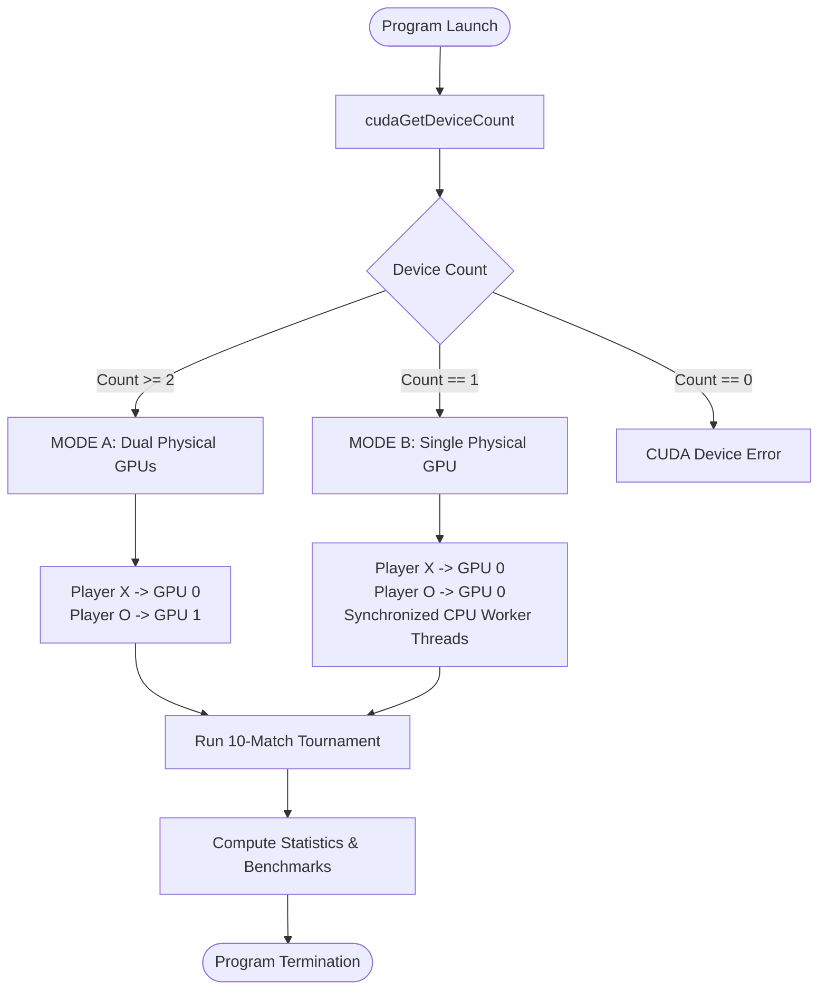
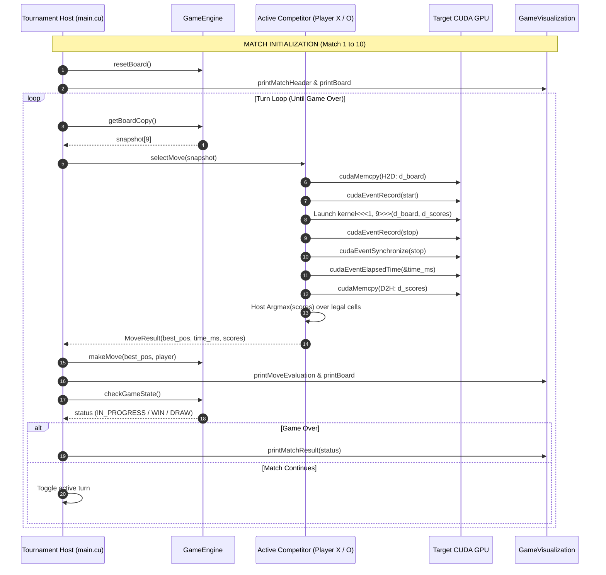

# System Architecture: CUDA GPU vs GPU Tic-Tac-Toe

This document provides a detailed technical architecture overview of the **CUDA GPU vs GPU – Intelligent Tic-Tac-Toe Battle** system. It describes the component interactions, data flows, parallel computing models, and thread synchronization mechanisms.

---

## 1. High-Level System Architecture

The application is structured into four distinct modular layers:

```
+-------------------------------------------------------------------------+
|                         APPLICATION LAYER                               |
|               (src/main.cu - Tournament Orchestrator)                   |
|   - CUDA Device Discovery & Mode Detection (Dual-GPU vs Single-GPU)     |
|   - 10-Match Tournament Execution & Starting Player Alternation         |
|   - Thread Synchronization & Turn Management                            |
+-------------------------------------------------------------------------+
                                    |
          +-------------------------+-------------------------+
          |                                                   |
          v                                                   v
+-----------------------------+             +-----------------------------+
|     COMPETITOR X LAYER      |             |     COMPETITOR O LAYER      |
|       (src/player_x.cu)     |             |       (src/player_o.cu)     |
| - Tactical Scoring Model    |             | - Strategic Threat Model    |
| - Host Memory Buffer        |             | - Host Memory Buffer        |
| - Device Memory Management  |             | - Device Memory Management  |
| - CUDA Event Kernel Timers  |             | - CUDA Event Kernel Timers  |
+-----------------------------+             +-----------------------------+
          |                                                   |
          v                                                   v
+-----------------------------+             +-----------------------------+
|    CUDA DEVICE KERNEL X     |             |    CUDA DEVICE KERNEL O     |
| (kernel_evaluate_player_x)  |             | (kernel_evaluate_player_o)  |
| - Grid: 1 Block, 9 Threads  |             | - Grid: 1 Block, 9 Threads  |
| - Evaluates all cells in || |             | - Fork & threat analysis || |
+-----------------------------+             +-----------------------------+
                                    |
          +-------------------------+-------------------------+
          |                                                   |
          v                                                   v
+-------------------------------------+   +-------------------------------+
|          GAME ENGINE LAYER          |   |     VISUALIZATION LAYER       |
|        (src/game_engine.cpp)        |   |  (src/game_visualization.cpp) |
| - 3x3 Board State & Validation      |   | - Terminal UI & Board ASCII   |
| - 8 Win-line Verification           |   | - Move Evaluation Telemetry   |
| - State Transitions & Draw checks   |   | - Tournament Statistics Table |
+-------------------------------------+   +-------------------------------+
```

---

## 2. Core Components

### 2.1 Game Engine (`GameEngine`)
- **Role**: Authoritative game arbitrator and rules manager.
- **State Space**: 9-element 1D array representing a $3 \times 3$ grid (`0 = Empty`, `1 = X`, `2 = O`).
- **Validation**: Ensures legal moves only (rejects bounds violations and occupied cells).
- **Termination Detection**: Checks the 8 fundamental geometric lines after each move (3 horizontal, 3 vertical, 2 diagonal). If 9 moves elapse without a line, declares a Draw.

### 2.2 Player X: Tactical CUDA AI (`PlayerX`)
- **Role**: Fast heuristic tactical competitor.
- **Assigned Hardware**: GPU 0 (Mode A) or GPU 0 Thread 0 (Mode B).
- **Core Heuristics**:
  1. Immediate win detection (+10,000 points).
  2. Immediate opponent block (+5,000 points).
  3. Center cell domination (+40 points).
  4. Corner preference over edges (+25 points vs +10 points).
  5. Open winning lines and path potential (+15 to +35 points).

### 2.3 Player O: Strategic CUDA AI (`PlayerO`)
- **Role**: Deep counter-play and fork-oriented strategic competitor.
- **Assigned Hardware**: GPU 1 (Mode A) or GPU 0 Thread 1 (Mode B).
- **Core Heuristics**:
  1. Immediate win detection (+10,000 points).
  2. Urgent opponent block (+6,500 points).
  3. Multi-threat Fork Creation (+3,500 points).
  4. Opponent Fork Prevention (+2,800 points).
  5. Opponent threat neutralization (+45 points per line disrupted).
  6. Strategic counter-positioning table.

### 2.4 Tournament Orchestrator (`main.cu`)
- Queries hardware capabilities using `cudaGetDeviceCount`.
- Instantiates competitors with target device identifiers.
- Executes 10 consecutive matches, alternating the starting player to eliminate first-player positional bias.
- Aggregates kernel execution latency (measured on-device via CUDA events) versus host orchestration latency.

---

## 3. GPU Execution & Concurrency Modes

The system automatically detects physical GPU topology at runtime:



### Mode A: Dual Physical GPUs
- When 2 or more physical CUDA devices are detected:
  - `PlayerX` invokes `cudaSetDevice(0)` before memory allocation and kernel launches.
  - `PlayerO` invokes `cudaSetDevice(1)` before memory allocation and kernel launches.
  - True hardware parallelism across two separate physical silicon chips.

### Mode B: Single Physical GPU (Coursera Environment Default)
- When 1 physical CUDA device is detected:
  - Both competitors target GPU 0 (`cudaSetDevice(0)`).
  - Two independent AI worker threads are created.
  - Coordination is enforced via `std::mutex` and `std::condition_variable` to guarantee strictly synchronized turn-taking.
  - GPU memory isolation is maintained: each competitor instance allocates its own independent device memory buffers (`d_board_`, `d_scores_`).

---

## 4. End-to-End Game Flowchart

The following flowchart illustrates the step-by-step game loop for each individual match:



---

## 5. Thread Safety & State Protection

To ensure thread safety in concurrent environments:
1. **Critical Section Protection**: The `GameEngine` instance and active turn state are protected by mutex locks during reads and writes.
2. **Decoupled GPU Computation**: The GPU kernel launch and device memory transfers operate on private copies of the board, allowing GPU compute without locking host state.
3. **Turn Barrier**: Condition variables signal the waiting thread only after the current move is validated and committed.
